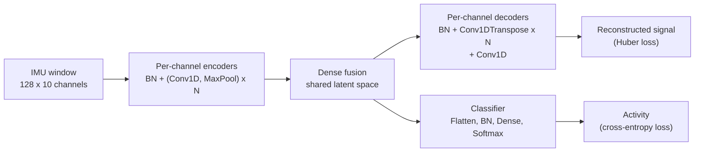
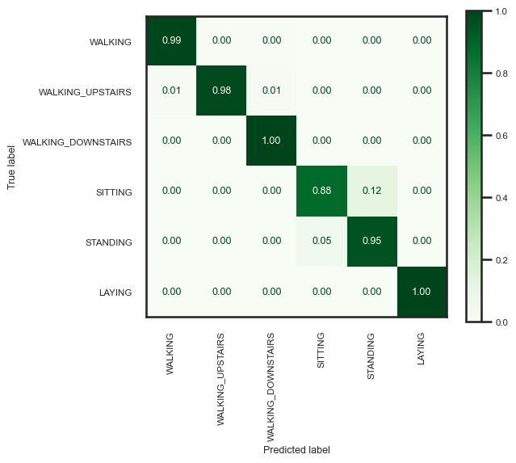

# Robust Feature Representation Using Multi-Task Learning for Human Activity Recognition

Demo code accompanying the paper
**[Robust Feature Representation Using Multi-Task Learning for Human Activity Recognition](https://www.mdpi.com/1424-8220/24/2/681)**
(*Sensors*, 2024, 24(2), 681).

Human Activity Recognition (HAR) models tend to lose accuracy on **subjects they have never seen**, because the same
activity looks different from person to person. This work tackles that by forcing the model to learn *why* a signal looks
the way it does, not just which label it has: the network has to **reconstruct the raw sensor signals and classify the
activity at the same time**, from one shared latent representation.

> **Note:** this repository is a **test demo** of the method on UCI-HAR only. Its results **will differ from those reported
> in the paper**, which used other datasets, longer training and its own tuned settings.

## The idea in short

- **Multi-channel asymmetric auto-encoder.** Every sensor channel (e.g. `acc_x`, `gyro_z`) gets its own small
  convolutional encoder. A dense layer fuses them into one latent space, and a decoder rebuilds every channel.
  *Asymmetric* means the encoder (Conv + MaxPool) and decoder (transposed Conv) are not mirror images.
- **Multi-task learning (MTL).** A very simple classification head (Flatten, BatchNorm, Dense, Softmax) is attached to the
  same latent space. The reconstruction loss (Huber) and the classification loss (cross-entropy) are optimised together,
  so the latent features must both describe the signal and separate the activities.
- **Why it helps.** The reconstruction task acts as a regulariser that shapes the shared features, which makes them more
  robust for subjects that were not in the training set. The paper also compares activation functions for reconstruction
  and finds SELU reconstructs periodic signals (such as walking) best.



The code can train three variants, selected with `--mode`:

| Mode | Components | Purpose |
|---|---|---|
| `MTL` | encoder + decoder + classifier | the proposed multi-task model |
| `classifier` | encoder + classifier | supervised baseline (no reconstruction) |
| `AE` | encoder + decoder | unsupervised baseline (reconstruction only) |

## Results

The paper evaluates on subjects held out from training and reports the following accuracies. These numbers are taken
from the paper; this repository only ships the UCI-HAR pipeline.

| Dataset | Accuracy (paper) |
|---|---|
| UCI-HAR | 99% |
| MHealth | 99% |
| PAMAP2 | 95% |
| USC-HAD | 88% |
| Alpine skiing (in-house) | 92% |

For a quick sanity check, the confusion matrix below comes from a short run of this code on UCI-HAR with the default
settings (10 epochs, 97% test accuracy). Longer training is needed to get close to the paper's figure.

<p align="center"></p>

## Project structure

```
HAR-MTL/
├── har_mtl/               # the library
│   ├── data.py            # UCI-HAR download + preprocessing
│   ├── models.py          # multi-channel asymmetric auto-encoder, classifier head, HParams
│   ├── training.py        # compile / fit for MTL, classifier and AE modes
│   ├── evaluation.py      # predictions, classification report, confusion matrix
│   └── utils.py           # seeding
├── notebooks/demo.ipynb   # step-by-step walkthrough
├── train.py               # command-line entry point
├── docs/                  # figures used in this README
└── requirements.txt
```

## Getting started

```bash
git clone https://github.com/<your-username>/HAR-MTL.git
cd HAR-MTL
python -m venv .venv && source .venv/bin/activate   # on Windows: .venv\Scripts\activate
pip install -r requirements.txt
```

Train and evaluate the multi-task model (UCI-HAR is downloaded to `data/` on the first run):

```bash
python train.py --mode MTL --epochs 100
```

Weights, training history, hyper-parameters, the classification report and the confusion matrix are written to
`outputs/<mode>/`. Run `python train.py --help` for all options (kernel size, filters, activation functions, loss weights,
single-channel variant, seed, ...). The same functionality is available from Python, see
[`notebooks/demo.ipynb`](notebooks/demo.ipynb):

```python
from har_mtl.data import load_uci_har
from har_mtl.models import HParams
from har_mtl.training import train

dataset = load_uci_har("data")
model, history = train(dataset, HParams(epochs=100), mode="MTL")
```

## Data and protocol

[UCI-HAR](https://archive.ics.uci.edu/dataset/240/human+activity+recognition+using+smartphones) contains smartphone
accelerometer and gyroscope recordings of 30 subjects performing six activities (walking, walking upstairs, walking
downstairs, sitting, standing, laying), pre-segmented into 128-sample windows at 50 Hz. The official subject-independent
split is used: 21 subjects for training and 9 unseen subjects for testing. 20% of the training windows are held out for
validation and early stopping. Besides the 9 raw channels, the magnitude of the total acceleration is added as a 10th
channel, and every channel is standardised with statistics fitted on the training data.

## Notes

- The paper describes four convolution blocks per channel encoder; the default here is `--num-layers 6`
  (which compresses the 128-sample window to a latent length of 2). It is configurable.
- Results vary with seed and training length. Fixed seeds are set for reproducibility, but exact numbers can still differ across
  hardware and TensorFlow builds.

## Citation

If you use this work, please cite:

```bibtex
@article{azadi2024robust,
  title   = {Robust Feature Representation Using Multi-Task Learning for Human Activity Recognition},
  author  = {Azadi, Behrooz and Haslgr{\"u}bler, Michael and Anzengruber-Tanase, Bernhard and Sopidis, Georgios and Ferscha, Alois},
  journal = {Sensors},
  volume  = {24},
  number  = {2},
  pages   = {681},
  year    = {2024},
  doi     = {10.3390/s24020681}
}
```
